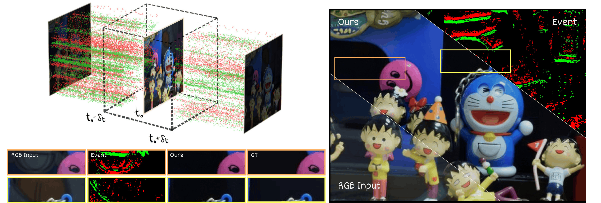
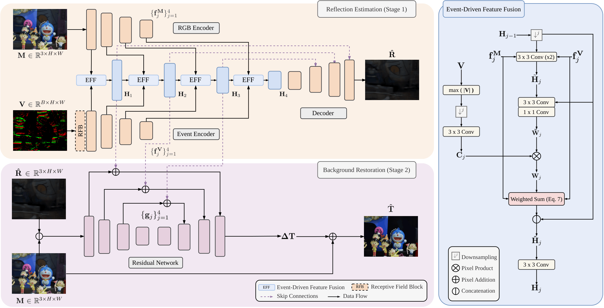

<div align="center">

# E-SIRR: Dynamic Reflection Removal from RGB Images via Event-Guided Multimodal Approach


<p align="center">
  
</p>

**Simone Melcarne, Sahar Husseini and Jean-Luc Dugelay**

Eurecom Research Center, Data Science Department, Biot, France


**19th European Conference on Computer Vision -- ECCV 2026, EBMV Workshop**

[](https://eventbasemultimodalvision.github.io/)
[](LICENSE)
[](https://pytorch.org/)

</div>

---

## The Framework

<p align="center">
  
</p>

Single-image reflection removal is inherently ill-posed: the same mixture image $M$ is consistent with infinite valid (transmission, reflection) pairs. **E-SIRR** resolves this ambiguity with an auxiliary **event camera**, exploiting the assumption of a **static background and a moving reflection**: under this constraint, the asynchronous event stream exclusively captures the high-frequency edges of the moving reflection layer, giving the network an explicit structural cue.

The task is formulated as a two-stage estimation problem: given a mixture image $M \in \mathbb{R}^{3 \times H \times W}$ and a synchronized event voxel grid $V \in \mathbb{R}^{B \times H \times W}$, the objective is to first estimate $$\hat{R} = \mathcal{R}(M, V), and finally to restore the background \hat{T} = \mathcal{T}(M, V, \hat{R})$$

### Key Components

* **Event Voxel Grid:** events falling within a symmetric temporal window around the frame timestamp are converted into a fixed-size $B$-bin voxel grid via a triangular temporal kernel (Eq. 5 of the paper).
* **Stage 1 — Reflection Estimation Network:** a dual-branch encoder (RGB + event, 4 scales, Residual Blocks + Group Normalization) extracts multi-scale features $\{f_j^M\}$, $\{f_j^V\}$. Before entering the event encoder, the raw voxel grid is first processed by a **Receptive Field Block (RFB)** — three parallel dilated convolutions (rates 1, 2, 3) concatenated and fused via 1×1 conv — to expand the receptive field prior to downsampling.
* **Event-Driven Feature Fusion (EFF):** at every scale $j$, a spatial gating mask $W_j$ (modulated by an **Event Confidence Map** $C_j$, computed as the max absolute voxel intensity across temporal bins) dynamically balances RGB and event features, letting the network discard the event contribution whenever $V$ is uninformative. A U-Net style decoder then predicts the intermediate reflection estimate $\hat{R}$.
* **Stage 2 — Background Restoration Network:** $M$ and $\hat{R}$ are concatenated (6 channels) and processed by a second residual encoder. **Cross-stage connections** re-inject the fused features $\{H_j\}$ from Stage 1 (through a zero-initialized 1×1 conv) to prevent high-frequency detail loss. The decoder predicts a residual $\Delta T$, added to $M$ to recover the clean transmission $\hat{T}$.
* **Composite Objective:** pixel (L1) + perceptual (VGG-19, relu1_2/relu2_2) losses supervise both stages, plus a multi-scale **exclusion loss** (3 pyramid levels) that explicitly discourages structural overlap between $\hat{T}$ and $\hat{R}$:

$$\mathcal{L}_{total} = \mathcal{L}_R(\hat{R}, R) + \mathcal{L}_T(\hat{T}, T) + \omega_e\, \mathcal{L}_{excl}(\hat{T}, \hat{R})$$

  with $\omega_\ell = 1.0$, $\omega_\phi = 0.1$, $\omega_e = 0.02$.

---
<div align="center">
### Visual Results
Qualitative comparison on synthetic data from SIR²⁺. From left to right: Input, Event Voxel, DSRNet, Zhu et al., RDNet, E-SIRR (Ours), and Ground Truth.
<p align="center">
  
</p>


Qualitative comparison on real-world data from ER-100. From left to right: Input, Event Voxel, DSRNet, Zhu et al., RDNet, E-SIRR (Ours), and Ground Truth.
<p align="center">
  
</p>
<div align="center">

## Dataset Preparation
Training requires triplets of mixture $M$, event voxel grid $V$, and ground-truth transmission/reflection layers $T$, $R$. The model is trained on a **large-scale synthetic dataset** built from COCO and evaluated both cross-dataset on **SIR²⁺** and on a **real-world event-camera benchmark (ER-100)** collected by the authors.

### 1. Dataset Generation Pipeline / Synthetic
The synthetic datasets are generated offline by blending RGB frames from the **COCO Dataset** (official dataset page: [https://cocodataset.org/](https://cocodataset.org/)) and simulating the event streams via **DVS-Voltmeter** (official repository: [https://github.com/Lynn0306/DVS-Voltmeter](https://github.com/Lynn0306/DVS-Voltmeter))
Run the generation script to create synthetic reflections moving along smooth 2D cubic-spline trajectories, with applied Gaussian blur to simulate defocus

```bash
python generate_training_dataset_COCO.py
```

### 2. Cross-Dataset Evaluation (SIR²⁺)
Run the following script to extend SIR2+ dataset with simulated event stream. Also mixture images are simulated. This dataset is used for testing on synthetic data.

```bash
python generate_testing_dataset_SIR2+.py
```


## Folder Structure

The dataloaders expect the generated datasets to follow a nested directory structure where each sample has its own folder containing all modalities:

```text
/path/to/dataset_root/
│
├── coco_coco_000000/
│   ├── coco_coco_000000_I_mixed.jpg    # M (Mixture input)
│   ├── coco_coco_000000_T_gt.jpg       # T (Transmission ground truth)
│   ├── coco_coco_000000_R_warped.jpg   # R (Reflection ground truth)
│   ├── coco_coco_000000_E_voxel.npy    # V (Event voxel grid, 5 bins)
│   ├── coco_coco_000000_E_sum.png      # Visualization of accumulated events
│   └── coco_coco_000000_meta.txt       # Generation parameters
│
├── coco_coco_000001/
...
```

---

## Installation

1. **Clone the repository**

```bash
git clone https://github.com/simonemelc/E-SIRR.git
cd E-SIRR
```

2. **Create and activate the environment**

```bash
conda create -n esirr python=3.10 -y
conda activate esirr
```

3. **Install dependencies**

```bash
conda install pytorch torchvision torchaudio pytorch-cuda=12.4 -c pytorch -c nvidia
pip install -r requirements.txt
```
If you plan to generate new synthetic data from scratch, clone and setup DVS-Voltmeter following their official instructions.

4. **Download our pretrained model**

We provide pre-trained models and the real-world E-SIRR dataset (with both raw event stream and already processed data into voxel grids). 

*   **Pre-trained Checkpoints:** [Download from Google Drive] (https://drive.google.com/drive/folders/1dhmRONzg__mRf-sXMtJpC-6jQ6-J_Gd3?usp=sharing)
*   **ER-100 (Real-World Benchmark):** [Download from Google Drive] (https://drive.google.com/drive/folders/120DMutAfjfOBnrXHZoiqugadrrg2xkgP?usp=drive_link)

Once downloaded, place the checkpoints in the `./checkpoints/` directory and extract the datasets into your `./data/` folder following the structure detailed above.

---

## Usage

### Training
To train the E-SIRR model end-to-end on the generated synthetic COCO dataset:

```bash
python train.py \
  --dataset_root ./data/synthetic/dvs \
  --output_dir ./outputs/train \
  --epochs 200 \
  --batch_size 4 \
  --lr 1e-4 \
  --base 48 \
  --ch_cap 192 \
```
Note: Use the --gray flag if you want to train the model in pseudo-grayscale mode for direct compatibility with native grayscale sensors.

### Evaluation

Cross-dataset zero-shot evaluation on SIR²⁺:

```bash
python test_SIR2+.py \
  --data_root ./data/synthetic_SIR2/dvs \
  --checkpoint ./checkpoints/best_model.pth \
  --dataset_type sir2plus \
  --save_root ./resultsSIR2+ \
```

Real-world evaluation on ER-100:

```bash
python test_RealDVS.py \
  --data_root ./data/ER-100/processed \
  --checkpoint ./checkpoints/best_model.pth \
  --save_root ./resultsRealDVS \
```

---

## Citation

If you find this work useful, please cite:

```bibtex
@inproceedings{melcarne2026dynamic,
  title={Dynamic Reflection Removal from RGB Images via Event-Guided Multimodal Approach},
  author={Melcarne, Simone and Husseini, Sahar and Dugelay, Jean-Luc},
  booktitle={ECCV 2026 Workshop-Event-Based Multimodal Vision: From Imaging to Perception and Understanding}
}
```

